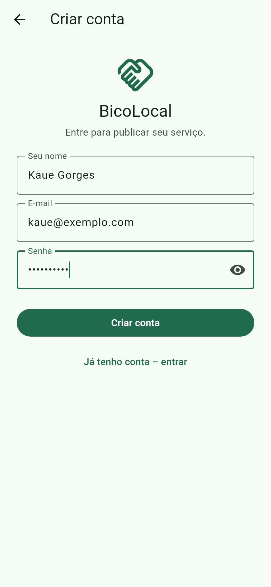
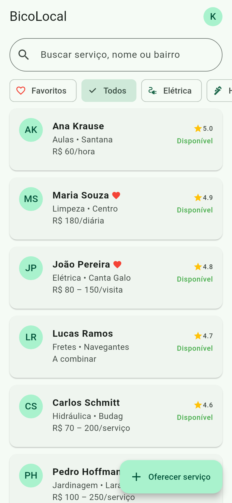
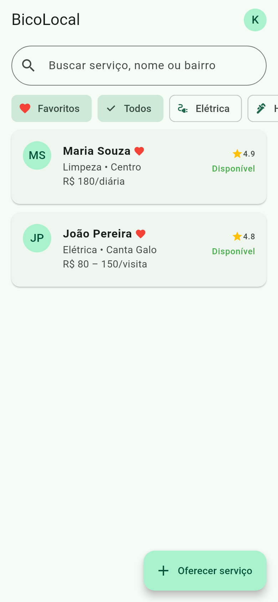
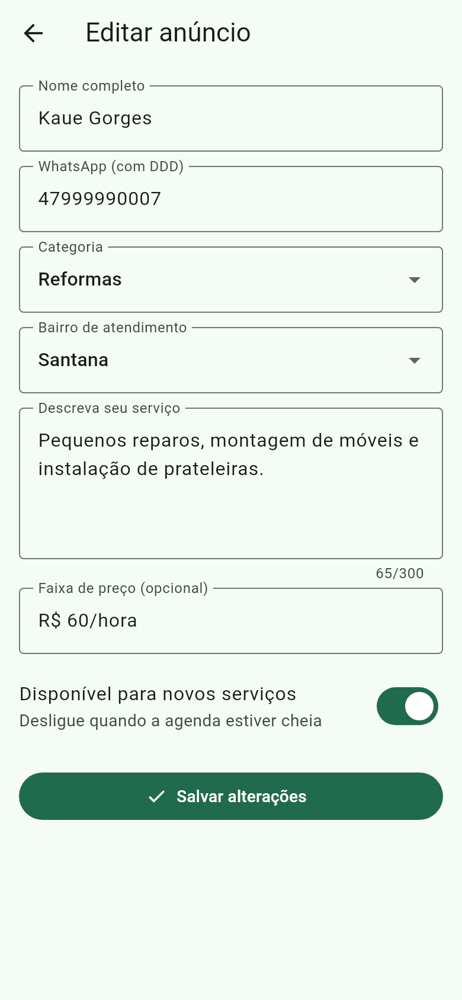

# BicoLocal

Aplicativo móvel (Flutter) que conecta **prestadores de serviços autônomos** ("bicos") — eletricistas, diaristas, encanadores, jardineiros, professores particulares, fretes — a **clientes de Rio do Sul e região**.

Projeto de Extensão – Desenvolvimento para Plataformas Móveis – Bacharelado em Sistemas de Informação – Unidavi (2026).

**Equipe:** Deivid Sestren · Kaue Gorges
**Professor:** Sandro Alencar Fernandes

## Funcionalidades (Entrega Final – 01/12/2026)

| ID | Requisito | Status |
|----|-----------|--------|
| RF01 | Listar prestadores ordenados por avaliação | ✅ |
| RF02 | Buscar por nome, serviço ou bairro | ✅ |
| RF03 | Filtrar por categoria | ✅ |
| RF04 | Detalhes do prestador (descrição, preço, disponibilidade, avaliação) | ✅ |
| RF05 | Contato pelo WhatsApp (mensagem pré-preenchida) e ligação | ✅ |
| RF06 | Cadastro de serviço com validação | ✅ |
| RF07 | Login e criação de conta (Firebase Authentication, e-mail e senha) | ✅ |
| RF08 | Persistência em nuvem, em tempo real (Cloud Firestore) | ✅ |
| RF09 | Avaliação do prestador pelo cliente (nota 1–5 + comentário) | ✅ |
| RF10 | Favoritos e edição/pausa/remoção do próprio anúncio | ✅ |

Navegar e buscar não exige login. Publicar serviço, avaliar e favoritar pedem login.

## Telas

| Login | Home | Favoritos | Detalhe e avaliações |
|---|---|---|---|
|  |  |  |  |

| Avaliar | Meus anúncios | Editar anúncio |
|---|---|---|
|  |  |  |

Prints da Entrega 1 em `docs/prints/`.

## Arquitetura

```
lib/
  main.dart                    # inicializa o Firebase (ou o modo demonstração) e o tema
  firebase_options.dart        # gerado pelo `flutterfire configure` (provisório no repositório)
  models/                      # Categoria, Prestador, Avaliacao, Usuario
  data/
    repositorio.dart           # ponto único de acesso das telas (ChangeNotifier)
    fonte_dados.dart           # interface da fonte de dados
    fonte_firestore.dart       # implementação Cloud Firestore
    fonte_memoria.dart         # implementação em memória (testes e modo demonstração)
    auth.dart                  # interface de autenticação + implementação em memória
    auth_firebase.dart         # implementação Firebase Authentication
    dados_exemplo.dart         # prestadores fictícios de exemplo
  screens/                     # Home, Detalhe, Cadastro/Edição, Login, Meus anúncios
  widgets/                     # PrestadorCard, estrelas, diálogo de avaliação
test/                          # testes do repositório e das telas
firestore.rules                # regras de segurança do Firestore
```

As telas falam só com o `Repositorio`, que depende das interfaces `FonteDados` e `ServicoAuth`. Assim, o mesmo app roda com Firebase (produção) ou em memória (testes automatizados e demonstração sem internet).

### Modelo de dados no Firestore

```
prestadores/{id}                     nome, categoriaId, descricao, bairro, telefone,
                                     faixaPreco, disponivel, donoUid,
                                     somaNotas, totalAvaliacoes, criadoEm
prestadores/{id}/avaliacoes/{uid}    autorUid, autorNome, nota (1–5), comentario, data
usuarios/{uid}                       favoritos: [ids de prestadores]
```

A média é `somaNotas / totalAvaliacoes`, atualizada numa **transação** a cada avaliação. Cada cliente tem uma avaliação por prestador (o id do documento é o uid dele); avaliar de novo substitui a nota anterior.

## Como executar

Requer Flutter 3.22+.

```bash
flutter pub get
flutter test
```

### Com Firebase

O projeto já está ligado ao Firebase `bicolocal-unidavi-2026-923d6` (Authentication por e-mail/senha + Cloud Firestore em `southamerica-east1`), e `lib/firebase_options.dart` já foi gerado. Basta:

```bash
flutter run                  # Android/iOS
flutter run -d chrome        # web
```

Com o banco vazio, crie uma conta no app e toque em **Carregar dados de exemplo** (aparece só em modo debug).

Para alterar as regras de segurança, edite `firestore.rules` e publique:

```bash
firebase deploy --only firestore:rules
```

Para usar outro projeto Firebase: `flutterfire configure --project=<id>` e atualize o `.firebaserc`.

### Sem Firebase (modo demonstração)

Se o Firebase não estiver configurado, o app abre automaticamente em **modo demonstração**, com dados de exemplo em memória e uma faixa avisando no topo. Para forçar esse modo:

```bash
flutter run --dart-define=DEMO=true
```

## Limitações conhecidas

- A média das notas é calculada no app (transação) e protegida pelas regras do Firestore. Em produção, o ideal seria uma Cloud Function para isso.
- Remover um anúncio não apaga a subcoleção de avaliações dele (os documentos ficam órfãos e não aparecem no app).
- Ainda não há moderação de anúncios nem verificação do telefone do prestador.
